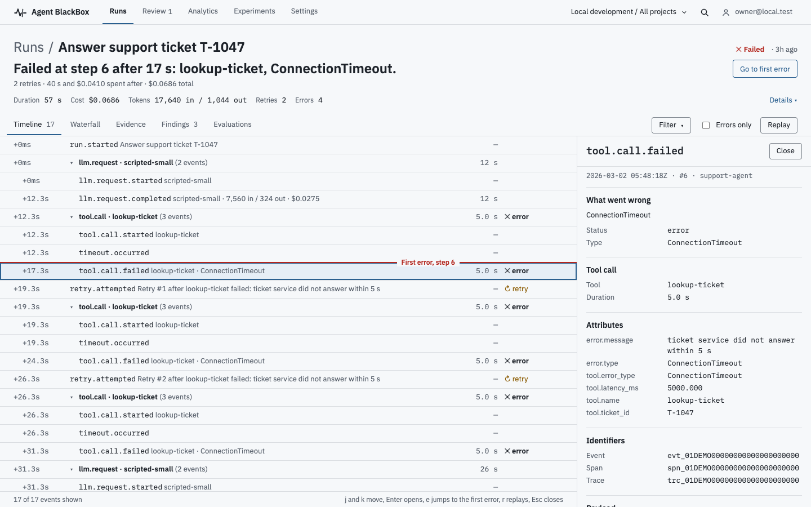
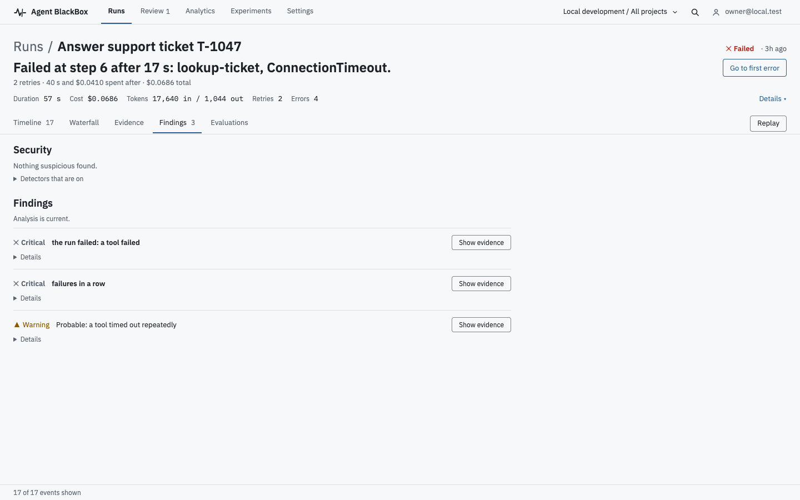
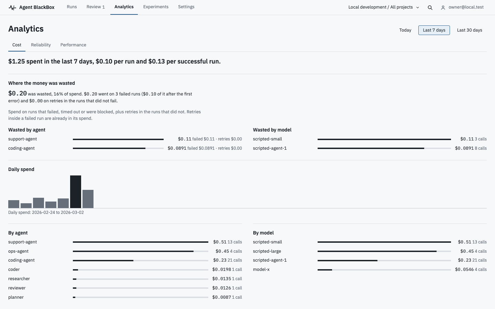

<p align="center">
  
</p>

# Agent BlackBox

**See what your agent actually did.** Agent BlackBox is a flight recorder for AI agents that you run yourself on Docker Compose
and PostgreSQL. It records every model call, tool call, command, file edit and retry as typed events, then shows you the step
where the run broke.
<!-- RELEASE_CLAIM: tagline. At G2 (repository public, LICENSE verified) the second sentence may be reworded to the positioning brief's one-sentence form with the hosting-model word ("self" + "hosted"), and a licence badge may be added. Source: positioning brief section 8. -->

<p align="center">
  
</p>

## What it is, and what it is not

It is:

- A record you can trust after the fact. Events are typed (a retry is a retry, a file edit is a diff, a command is a command)
  and accepted events are immutable. Summaries, costs and findings are derived from them and can be rebuilt.
- A small stack: API, worker, web app and PostgreSQL. No Kafka, no ClickHouse, no Redis.
- A standard-library Python SDK with a bounded buffer. If it fails, your agent keeps running.

It is not:

- A cloud product. There is no cloud version and none is planned for this release.
- A guard that stops every bad action. Policies and approvals apply to agents that ask through the SDK guard; code that
  bypasses the guard is recorded, not stopped.
- Proven at scale. No load test exists, so this page makes no throughput, overhead or capacity claim.
- A replacement for your tracing stack. It maps to OpenTelemetry at the boundary; it does not ingest OTLP today.

## What you can do with it

Each item below is a screen in the web app, not a mock-up.

| You want to know | Where to look |
| --- | --- |
| Where did the run break? | The run headline ("Failed at step 7 after 6.2 s: run_migration, ConnectionTimeout.") and the red first-error line on the timeline |
| Why is this a problem? | Findings, from deterministic detectors for loops, retry storms, repeated requests, context growth, cost spikes and failure chains, plus six security detectors. Each finding links to the events it was built from ("Show evidence") |
| What did it cost, and what was wasted? | Analytics, Cost: spend per run and per agent, and how much went to failed runs, retries and spend after the first error |
| What did many agents do? | The Waterfall tab: one lane per agent, the critical path, the spans with no recorded end |
| Did the change matter? | Compare: two runs aligned step by step, with the step where they diverged |
| Can I make it wait for a person? | Review, Approvals: an approval covers one exact action, once. Applies to agents that ask through the SDK guard |

<p align="center">
  
  
</p>

## Quickstart

You need Docker with Compose, [uv](https://docs.astral.sh/uv/) and Git. No account and no model API key. Full walkthrough,
including a failed run: [`docs/quickstart.md`](docs/quickstart.md).

```bash
git clone https://github.com/abdullahimohamed101/agent-black-box.git
cd agent-black-box
cp .env.example .env
make up      # PostgreSQL, migrations, API, worker, web (the first build takes several minutes)
make seed    # workspace "local", project "demo", a development key in .local/dev-api-key
make demo    # records twelve scripted runs (four example agents) into the running stack and prints the run links
```
<!-- RELEASE_CLAIM: the clone URL points at the public repository; it only resolves after G2. Until then clone from your local checkout. -->

Open <http://localhost:3000>, choose "Sign in" and use `owner@local.test` (the development sign-in provider accepts any
email). The demo project is `abb-demo`. Stop with `make down`; `make demo-reset` shows what removing the demo project would
delete and changes nothing unless you pass `CONFIRM=1`.

Trace your own agent. Install the SDK from this checkout (it has no runtime dependencies), then:

```python
from blackbox import BlackBox

bb = BlackBox(api_key=..., endpoint="http://localhost:8000", project="demo")
with bb.run("Fix OAuth timeout") as run:
    with run.span("run-tests", kind="tool"):
        agent.execute()
bb.shutdown()
```

Install from source with `pip install ./packages/sdk-python`. There is no published package yet.
<!-- RELEASE_CLAIM: replace the install-from-source line with the package install only after the package name is checked and published (Q4). -->

## Examples

The examples are scripted by default: fixed model replies and a made-up price table, so they need no key and no network, and
record the same spans, errors, retries and costs every time (ids and timestamps differ). `make demo` runs them, plus a scripted ops agent (`examples/python/ops_agent.py`), for twelve runs in all.

| Example | What it records |
| --- | --- |
| [`examples/coding-agent`](examples/coding-agent/README.md) | A small coding agent fixes a broken OAuth service: file reads and edits with diffs, shell commands and test output, one failing test, a retry, a commit. A `wrong-fix` variant ends in failure |
| [`examples/python`](examples/python/README.md) | A support agent whose tool call times out and is retried; the shortest custom-agent sample |
| [`examples/multi-agent`](examples/multi-agent/README.md) | A planner, researcher, coder, a tester in a separate process and a reviewer in one run; open the Waterfall tab. Scripted only |

A `--live` flag exists on the coding-agent and the custom agent. It is available and untested: the project has not run it
(KI-044).

## Integrations

Adapters for LangGraph, OpenAI, Anthropic and MCP live in [`integrations/`](integrations/) and are described in
[`docs/architecture/integrations.md`](docs/architecture/integrations.md). They are tested offline against the real
libraries, not against live providers. Framework-specific shapes stay inside the adapters; the API only sees the canonical
event contract ([`docs/architecture/events.md`](docs/architecture/events.md)).

## Architecture

```text
Agent / framework -> adapter -> SDK -> POST /v1/events/batch -> ingestion (FastAPI)
   -> PostgreSQL (events + outbox) -> workers (summary, cost, findings) -> derived tables
   -> query API and SSE -> Next.js web app
```

A modular monolith on purpose. The stable asset is the versioned event contract, not the datastore; Kafka, ClickHouse, Redis
and Kubernetes wait for a measured trigger. Ingestion is at-least-once and idempotent on `(workspace_id, event_id)`, arrival
order is never trusted, and every tenant read carries workspace context. More in [`ARCHITECTURE.md`](ARCHITECTURE.md).

```text
apps/{api,web}  packages/{event-schema,sdk-python}  integrations/{langgraph,openai,anthropic,mcp,conformance}
examples/{coding-agent,python,multi-agent}  site/  scripts/  docs/
```

## Security and privacy

- Your data stays on the machine that runs the stack. The SDK sends to the endpoint you configure and nowhere else.
  <!-- RELEASE_CLAIM: add "the product and the landing page make no request to a third party" only after the Playwright request log (AC11, AC15, step 17) passes. -->
- Capture is metadata-only by default. Prompts, tool results and file contents are dropped unless you opt in per project
  (`full` keeps payloads after redaction; `disabled` keeps nothing).
- Secrets the scanner recognises are redacted before anything is stored, and the stored copy keeps a
  `[REDACTED:credential]` marker. Redaction is best effort: a secret with an unknown shape can pass in full-capture mode, and
  stored events are never scrubbed afterwards. Keep secrets out of events when you can.
- Captured telemetry is treated as hostile input. API keys are stored as hashes, every tenant query is scoped by workspace, and
  access is invitation-only.
- Development sign-in and the seeded owner are for your laptop. The compose settings in the quickstart are development
  values; read [`docs/deployment.md`](docs/deployment.md) before letting anyone else use the stack.

Threat model and known gaps: [`docs/SECURITY.md`](docs/SECURITY.md). To report a vulnerability, follow
[`SECURITY.md`](SECURITY.md); do not open a public issue.

## Project status

Early release. There is no version promise: interfaces and the event contract can still change between commits, and there
are no upgrade guarantees yet. Four limits to know before you start:

1. Single node on Docker Compose. There is no hosting guide yet (TLS, a domain and a real identity provider are documented as
   not covered).
2. Real-model mode exists in two examples and has not been run by the project.
3. Policy enforcement is cooperative: it applies to agents that ask through the SDK guard.
4. No load test exists, so there are no capacity or overhead numbers.

The roadmap is [`docs/IMPLEMENTATION_PLAN.md`](docs/IMPLEMENTATION_PLAN.md); open problems are in
[`docs/KNOWN_ISSUES.md`](docs/KNOWN_ISSUES.md).

## Documentation

Start at the index, [`docs/README.md`](docs/README.md). Common destinations:
[quickstart](docs/quickstart.md), [troubleshooting](docs/troubleshooting.md), [deployment on one machine](docs/deployment.md),
[Python SDK](docs/architecture/sdk-python.md), [HTTP API](docs/architecture/api-v1.md), [operations](docs/OPERATIONS.md) and
[runbooks](docs/runbooks/README.md).

## Contributing

Read [`CONTRIBUTING.md`](CONTRIBUTING.md) and the [code of conduct](CODE_OF_CONDUCT.md). Development setup is in
[`docs/development/setup.md`](docs/development/setup.md); `scripts/quality.sh full` is the single gate used by CI. Contributors
who are AI agents should start at [`AGENTS.md`](AGENTS.md).

## License

Apache-2.0. See [`LICENSE`](LICENSE) and [`NOTICE`](NOTICE).
<!-- RELEASE_CLAIM: at G2 (repository public) this section may state the licence-based project description and carry a licence badge; not before. -->
